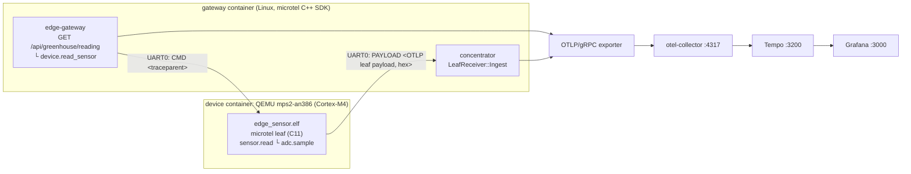

# `demo-edge-trace`: one trace from a Linux service into a microcontroller

A request hits a Linux service, the service asks a Cortex-M4 microcontroller
for a sensor reading over a serial line, and **Grafana Tempo shows the whole
thing as one trace**: the service's spans and the firmware's spans, linked
parent → child through a W3C `traceparent` that crossed the UART.

- **The device** is real bare-metal firmware: C11, the microtel **leaf**
  library, no RTOS, no heap, about 26 KiB of flash and 12 KiB of RAM. It runs
  on **QEMU's Arm MPS2 AN386 board (Cortex-M4)**. Nothing about it is simulated
  on the host: the same ELF would run on the FPGA board.
- **The gateway** is a Linux C++ service built on the microtel SDK. It's also
  the device's **concentrator**: it takes the device's encoded payloads and
  exports them along with its own spans over OTLP/gRPC.
- **The backend** is the same collector, Tempo and Grafana as
  [`examples/stack`](../stack/).



## Run it

You need Docker with Compose v2. The first build compiles microtel and the
firmware, which takes a few minutes.

```bash
cd examples/demo-edge-trace
docker compose up --build
```

The gateway makes one request every 5 seconds:

```
gateway-1  | edge-gateway: connected to the device
gateway-1  |   device: request 1: 2 spans, 557 bytes
gateway-1  | request 1: trace_id=4fa3911591ca55253d51fa736c83c289 device_spans=2
```

Open <http://localhost:3000>, go to **Explore → Tempo**, and search for
`{ resource.service.name = "mcu-sensor" }`, or paste a `trace_id` from the
log. Each trace looks like this:

```
edge-gateway  GET /api/greenhouse/reading        (SERVER)
edge-gateway  └─ device.read_sensor              (CLIENT; its traceparent goes over the UART)
mcu-sensor       └─ sensor.read                  (SERVER, started on the MCU with the remote parent)
mcu-sensor          └─ adc.sample                (INTERNAL)
```

<!-- TODO(screenshot): put a Grafana trace-view screenshot or a short GIF of
     this trace here, e.g. docs/images/demo-edge-trace.png. -->

To check it from the command line, which is what CI does:

```bash
python3 verify_trace.py http://localhost:3200    # PASS: trace ... spans both services
```

To stop the demo: `docker compose down`. `CYCLES=3 docker compose up` makes
three requests and then the gateway exits.

## How it works

**The serial protocol** is one line in each direction per request:

| Direction | Line |
|---|---|
| gateway → device | `CMD 00-<trace-id>-<span-id>-01`: the W3C traceparent of `device.read_sensor` |
| device → gateway | `LOG <text>`: informational, printed by the gateway |
| device → gateway | `PAYLOAD <hex>`: one encoded leaf payload, both spans |

**On the device** ([`firmware/edge_sensor.c`](firmware/edge_sensor.c)), the
firmware parses the traceparent and calls `microtel_leaf_span_start_remote` so
that `sensor.read` is a child of the gateway's span. It then records
`adc.sample` under it, encodes the batch with `microtel_leaf_encode` into a
static buffer, and writes it out hex-encoded. The board layer
([`firmware/board_mps2.c`](firmware/board_mps2.c)) is about 150 lines: the
vector table, a 1 kHz SysTick for the leaf's clock, and a polled CMSDK UART.
The device runs in concentrator-stamped time mode, so it needs no wall clock.

**On the gateway** ([`gateway/edge_gateway.cpp`](gateway/edge_gateway.cpp)),
one `Provider` is built with `WithLeafReceiver(...)`. The gateway's own spans
and the device's ingested spans share its batch processor and exporter. The
device's spans keep their own Resource (`service.name = mcu-sensor`,
`cpu.model = cortex-m4`), and the concentrator adds `device.id`.

**The UART** is QEMU's `-serial tcp:0.0.0.0:5555,server=on`. On hardware it
would be `/dev/ttyUSB0`, and only `UartLink` would change.

## Without containers

```bash
# firmware (needs gcc-arm-none-eabi, libnewlib-arm-none-eabi)
cmake -S examples/demo-edge-trace/firmware -B build-fw -G Ninja \
    -DCMAKE_TOOLCHAIN_FILE=$PWD/cmake/toolchains/arm-none-eabi.cmake \
    -DMICROTEL_LEAF_CPU=cortex-m4 -DCMAKE_BUILD_TYPE=MinSizeRel
cmake --build build-fw

# gateway
cmake -S . -B build -G Ninja -DMICROTEL_BUILD_EXAMPLES=ON -DMICROTEL_WITH_CONCENTRATOR=ON
cmake --build build --target microtel_example_edge_gateway

examples/stack/up.sh                                      # collector, Tempo, Grafana
qemu-system-arm -M mps2-an386 -nographic -monitor none \
    -kernel build-fw/edge_sensor.elf -serial tcp:127.0.0.1:5555,server=on,wait=off &
DEVICE_ADDR=127.0.0.1:5555 CYCLES=3 ./build/examples/microtel_example_edge_gateway
python3 examples/demo-edge-trace/verify_trace.py
```

## Files

| Path | What |
|---|---|
| `firmware/` | Cortex-M4 firmware: leaf usage, board layer, linker script, standalone CMake project |
| `gateway/edge_gateway.cpp` | Linux service + concentrator |
| `docker/` | Dockerfiles for the device (cross-build + QEMU) and the gateway |
| `compose.yaml` | The whole demo, reusing `examples/stack` configs |
| `verify_trace.py`, `smoke.sh` | The CI check (`.github/workflows/demo-edge-trace.yml`) |

The leaf and concentrator design is
[`docs/leaf-concentrator-design.md`](../../docs/leaf-concentrator-design.md);
the basic leaf example is [`examples/leaf`](../leaf/).
